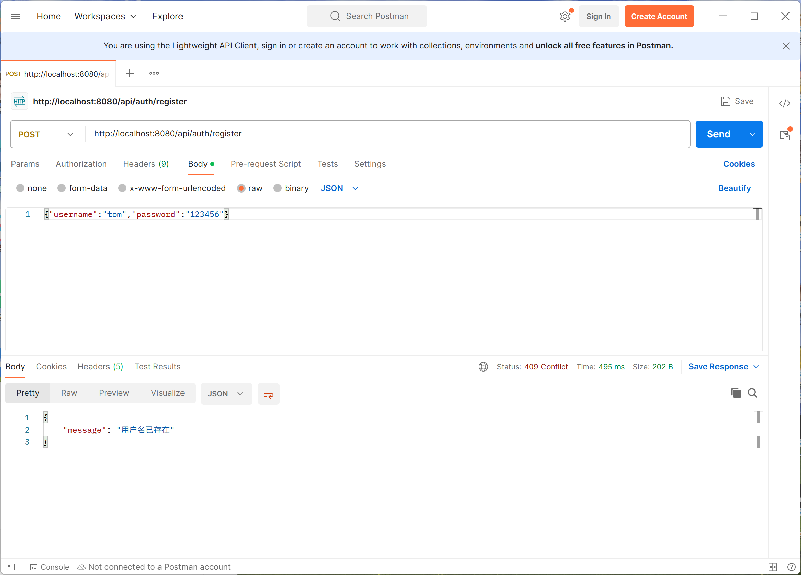
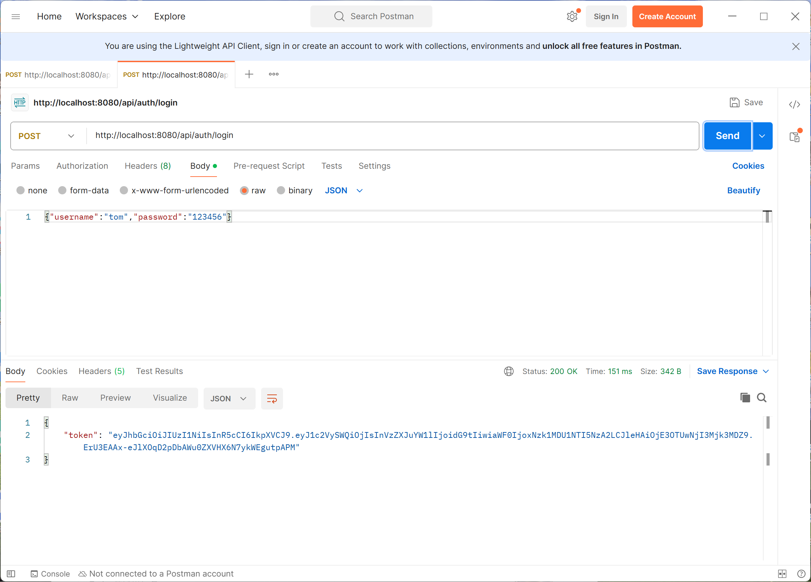
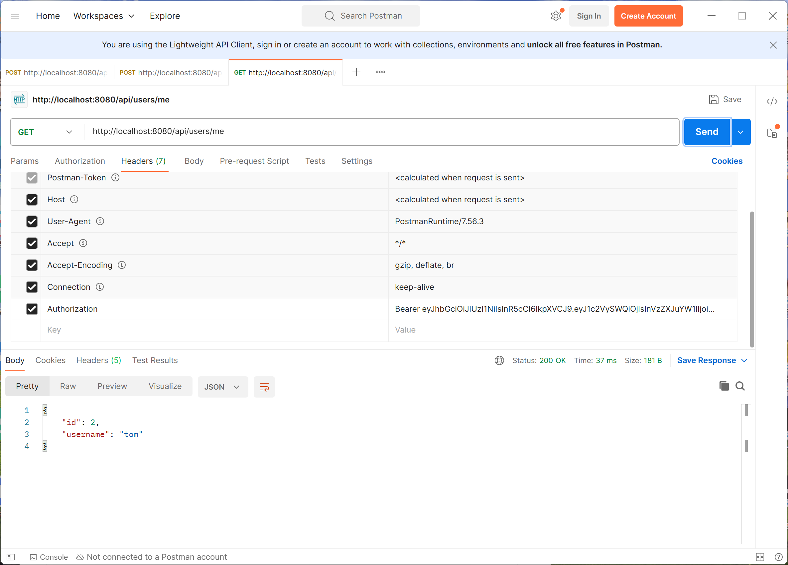
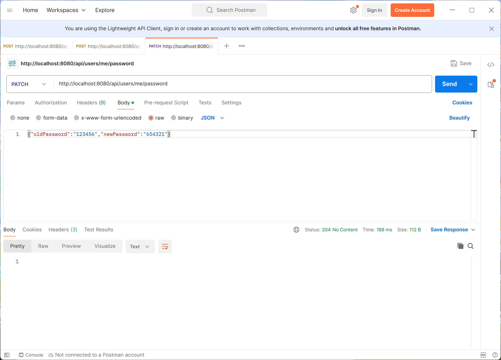
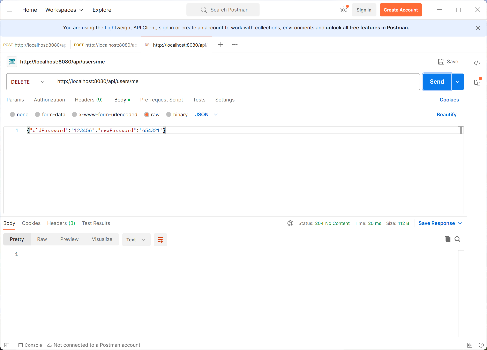
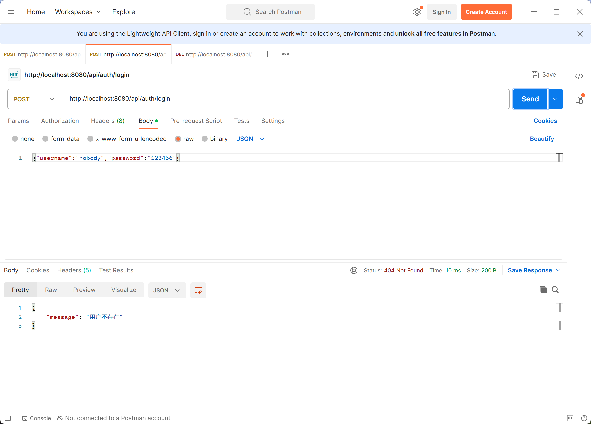
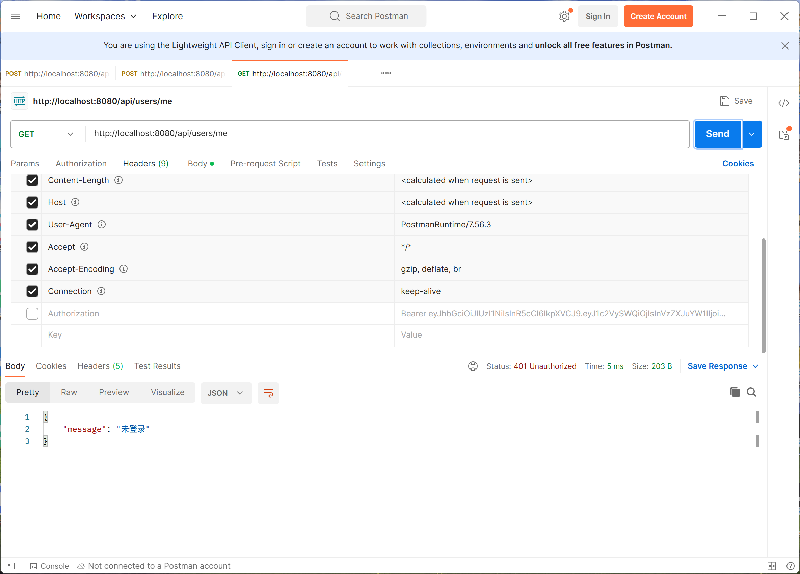

# 用户管理系统

择栖工作室 2026 年招新题（后端方向）第四、五题的实现。第四题为用户管理系统基础功能，第五题在其基础上扩展了 JWT 认证、密码安全存储、统一异常处理和日志记录。一个项目同时覆盖两道题。

## 技术栈

- Java 21
- Spring Boot 4.1.2
- Spring Data JPA
- MySQL
- Lombok
- JWT（手写实现，HMAC-SHA256）

## 环境要求

- JDK 21
- MySQL 8.0+
- Maven 3.6+

## 快速开始

### 1. 创建数据库

```sql
CREATE DATABASE demo CHARACTER SET utf8mb4;
```

### 2. 配置敏感信息

项目不提交真实密码和密钥。在 `src/main/resources/` 下创建 `application-local.properties`，内容如下：

```properties
spring.datasource.password=你的MySQL密码
jwt.secret=你的JWT密钥
```

`jwt.secret` 建议使用足够长的随机字符串（至少 32 字节），可用以下命令生成：

```bash
openssl rand -hex 32
```

### 3. 启动

本地开发使用 `local` profile 启动：

```bash
mvn spring-boot:run -Dspring-boot.run.profiles=local
```

或在 IDEA 中，在运行配置的 Active profiles 中填入 `local`。

应用默认运行在 `http://localhost:8080`，数据库表会通过 JPA 自动创建。

## 认证模式

项目支持两种认证模式，通过 `application.properties` 中的 `auth.mode` 切换：

- `jwt`（默认）：登录返回 JWT，请求头携带 `Authorization: Bearer <token>`
- `session`：登录返回 sessionId，请求头携带 `sessionId: <sessionId>`

## 接口列表

### 认证相关

| 方法 | 路径 | 说明 | 认证 |
| --- | --- | --- | --- |
| POST | `/api/auth/register` | 用户注册 | 无 |
| POST | `/api/auth/login` | 用户登录 | 无 |

### 用户相关

| 方法 | 路径 | 说明 | 认证 |
| --- | --- | --- | --- |
| GET | `/api/users/me` | 查看当前登录用户 | 需要 |
| GET | `/api/users` | 查看用户列表 | 需要 |
| PATCH | `/api/users/me/username` | 修改用户名 | 需要 |
| PATCH | `/api/users/me/password` | 修改密码 | 需要 |
| DELETE | `/api/users/me` | 注销账号 | 需要 |

### 请求与响应示例

注册：

```
POST /api/auth/register
请求体：{"username":"tom","password":"123456"}
成功：201 {"id":1,"username":"tom"}
重复：409 {"message":"用户名已存在"}
```

登录：

```
POST /api/auth/login
请求体：{"username":"tom","password":"123456"}
成功：200 {"token":"xxx.yyy.zzz"}
密码错误：401 {"message":"密码错误"}
用户不存在：404 {"message":"用户不存在"}
```

## 状态码说明

| 状态码 | 场景 |
| --- | --- |
| 200 | 操作成功 |
| 201 | 注册成功 |
| 400 | 参数校验失败 |
| 401 | 未登录、token 无效、密码错误 |
| 404 | 用户不存在 |
| 409 | 用户名已存在 |
| 500 | 服务器内部错误 |

## 项目结构

```
com.example.demo
├── controller   # REST 接口
├── service      # 业务逻辑
├── repository   # 数据访问层
├── entity       # 数据库实体
├── dto          # 请求/响应对象
├── auth         # JWT、Session、认证拦截器
├── exception    # 业务异常与全局异常处理
└── config       # 配置类
```

## 测试结果

全部接口已用 Postman 实测，截图存放于 `docs/screenshots/`。

### 正常流程

| 步骤 | 接口 | 状态码 | 结果 |
| --- | --- | --- | --- |
| 注册 | POST `/api/auth/register` | 201 | `{"id":4,"username":"jerry"}` |
| 登录 | POST `/api/auth/login` | 200 | 返回 JWT |
| 查看当前用户 | GET `/api/users/me` | 200 | `{"id":2,"username":"tom"}` |
| 用户列表 | GET `/api/users` | 200 | 用户数组 |
| 修改用户名 | PATCH `/api/users/me/username` | 200 | `{"id":2,"username":"tom2"}` |
| 修改密码 | PATCH `/api/users/me/password` | 204 | 无响应体 |
| 注销账号 | DELETE `/api/users/me` | 204 | 无响应体 |

### 异常场景

| 场景 | 接口 | 状态码 | 响应 |
| --- | --- | --- | --- |
| 重复注册 | POST `/api/auth/register` | 409 | `{"message":"用户名已存在"}` |
| 密码错误 | POST `/api/auth/login` | 401 | `{"message":"密码错误"}` |
| 用户不存在 | POST `/api/auth/login` | 404 | `{"message":"用户不存在"}` |
| 未携带 token | GET `/api/users/me` | 401 | `{"message":"未登录"}` |

### 截图

<details>
<summary>展开查看全部 12 张截图</summary>

**注册成功 201**


**重复注册 409**



**登录成功 200**



**查看当前用户 200**



**用户列表 200**


**修改用户名 200**


**修改密码 204**



**注销账号 204**



**重复注册 409**


**密码错误 401**


**用户不存在 404**



**未登录 401**



</details>

### 数据库中的密码存储

注册后的密码以 BCrypt 哈希形式存储，不保存明文：

```sql
SELECT id, username, password FROM users;
-- password 字段形如 $2a$10$N9qo8uLOickgx2ZMRZoMy...
```
